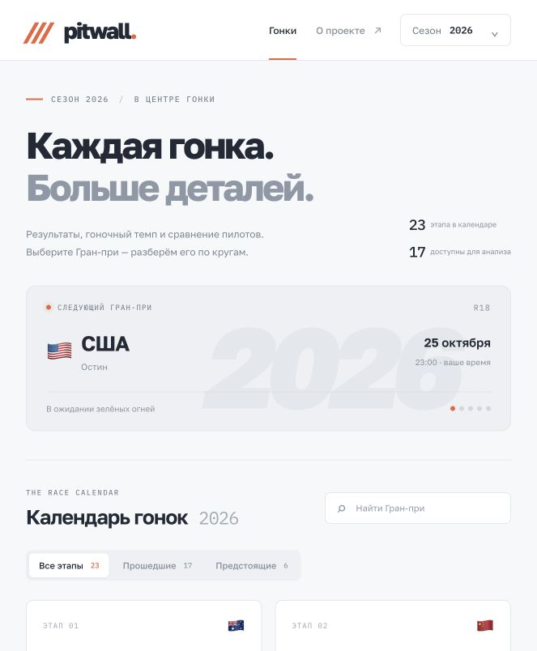

# Pitwall — Formula 1 Race Lab

[](https://github.com/ashetbalay/pitwall/actions/workflows/test.yml)


Разбор завершённых гонок Формулы-1: результаты, покруговка, пит-стопы и сравнение пилотов. Python backend на FastAPI, небольшой клиент на JavaScript и реальные данные Jolpica / OpenF1. История начинается с сезона 2025.



## Что можно сделать

- Открыть календарь актуального сезона или выбрать прошедший сезон, начиная с 2025.
- Найти Гран-при и отфильтровать прошедшие или предстоящие этапы.
- Посмотреть протокол, стартовые позиции, очки и лучший круг.
- Изучить времена кругов выбранного пилота на графике и в таблице.
- Посмотреть пит-стопы и отрезки на разных составах шин.
- Сравнить двух пилотов по итогам и медианной разнице на общих кругах.

Предстоящие гонки недоступны. Статистика открывается после публикации результата; API также проверяет это условие. При недоступности провайдера календарь использует сохранённые данные и показывает дату снимка. Отсутствующие значения не заменяются выдуманными результатами.

## Запуск

Нужны Python 3.11+ и [uv](https://docs.astral.sh/uv/).

```sh
git clone https://github.com/ashetbalay/pitwall.git
cd pitwall
uv sync --frozen
uv run uvicorn backend.main:app --reload --port 8000
```

Приложение: [localhost:8000](http://127.0.0.1:8000). Интерактивная документация API: [localhost:8000/docs](http://127.0.0.1:8000/docs).

**macOS:** после клонирования можно дважды нажать `start.command` в Finder или выполнить:

```sh
./start.command
```

Launcher выберет свободный порт, выведет адрес и откроет браузер после готовности сервера. Для остановки — Ctrl+C в терминале. Кроссплатформенный вариант с выбором порта:

```sh
uv run python launcher.py
```

**Docker:**

```sh
docker build -t pitwall .
docker run --rm -p 8000:8000 pitwall
```

Если порт занят: `docker run --rm -p 8001:8000 pitwall`, затем откройте `http://127.0.0.1:8001`.

## Устройство проекта

| Часть | Реализация |
|---|---|
| API и раздача интерфейса | FastAPI, uvicorn |
| Получение данных | httpx, фиксированные адреса Jolpica / OpenF1 |
| Кеш | SQLite с TTL и параметризованными запросами |
| Интерфейс | JavaScript ES modules, CSS, SVG-графики |
| Аналитика MVP | Медианы и сравнение кругов в `frontend/analysis.js` |
| Проверки | pytest, node:test, GitHub Actions |
| Запуск | uv, Docker, macOS launcher |

```text
backend/
  main.py          API, провайдеры и резервные снимки
  domain.py        правила доступности и сопоставление сессий
  cache.py         SQLite-кеш ответов
frontend/
  app.js           маршруты и экраны
  data.js          слой получения данных
  analysis.js      расчёты сравнения
  styles.css       оформление
  data/            датированные снимки источников
launcher.py        запуск на свободном порту
refresh_data.py    обновление снимков
```

Подробнее: [архитектура и ограничения решений](docs/architecture.md), [разработка](CONTRIBUTING.md).

## API

| Метод | Путь | Ответ |
|---|---|---|
| GET | `/api/seasons` | Доступные сезоны и текущий год |
| GET | `/api/seasons/{year}/races` | Календарь и доступность гонок |
| GET | `/api/seasons/{year}/races/{round}` | Итоговый протокол |
| GET | `/api/seasons/{year}/races/{round}/timing?kind=laps` | Покруговка; также `pit` и `stints` |
| GET | `/api/health` | Состояние сервиса |

API возвращает 404 для неизвестного сезона/гонки, 409 для ещё не завершённой гонки с результатом и 503 при недоступности источника без подходящего снимка. Параметр `kind` ограничен допустимыми значениями.

## Проверки

Для JavaScript нужен Node.js 22+. npm-зависимостей нет, `npm install` не требуется.

```sh
uv run --frozen pytest -q
npm run check
npm test
```

Тесты проверяют блокировку будущих гонок, работу API, отказ провайдера, сопоставление сессий, кеш, выбор свободного порта и сравнение несовпадающих наборов кругов. Они не требуют доступности внешних F1 API. GitHub Actions запускает Python-тесты на 3.11 и 3.13, JavaScript-проверки и сборку Docker с HTTP smoke test.

## Источники и обновление данных

- [Jolpica](https://github.com/jolpica/jolpica-f1/blob/main/docs/README.md) — календарь и итоговые результаты.
- [OpenF1](https://openf1.org/docs/) — круги, пит-стопы и отрезки на шинах.

В `frontend/data/manifest.json` записаны время получения снимков и источники. Обновление:

```sh
uv run python refresh_data.py --with-timing
```

Скрипт сохраняет календарь и результаты сезонов с 2025 по текущий, а также подробные данные последней завершённой гонки каждого сезона. Остальная покруговка загружается по запросу. Для обновления снимков в развёрнутом экземпляре нужно повторно развернуть обновлённый код.

## Границы первой версии

- SQLite используется для кеша, а не как нормализованная база гонок. PostgreSQL и фоновый импорт пока не реализованы.
- Расчёты сравнения выполняются в клиенте. Серверная аналитика — следующий этап.
- В анализе исключаются круги без положительного времени и круги выезда из боксов. Въезд в боксы, Safety Car, трафик, шины и топливная загрузка не корректируются.
- Медианная разница считается по одинаковым номерам кругов; личная медиана каждого пилота — по его доступным кругам. Это описательная статистика, а не оценка качества стратегии.
- Источники имеют лимиты и могут не предоставлять подробности конкретного этапа. Снимки результатов могут устаревать после пересмотра штрафов.
- Основной режим — Python-сервер. Статический клиент может работать отдельно через публичные API, но Python backend в этом режиме отсутствует. Сам репозиторий на GitHub не запускает сервер.
- Нет аккаунтов, live-тайминга и автоматического обновления снимков по расписанию.

Проект не связан с Formula 1 и FIA. Шрифты Golos Text и IBM Plex Mono загружаются с Google Fonts; предусмотрены системные замены.
