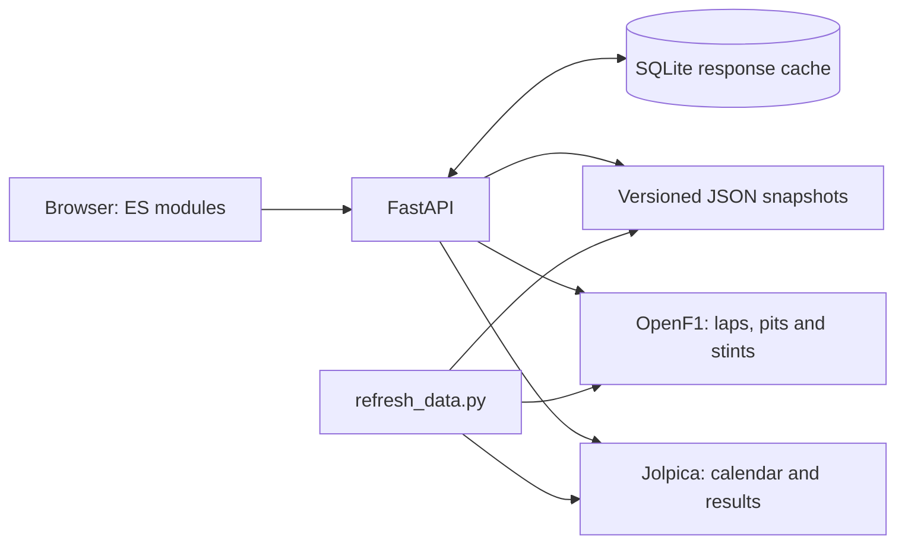

# Архитектура и решения

## Граница доступности гонки

Прошедшая дата сама по себе не открывает статистику. Требуется опубликованный итоговый результат. Проверка выполняется и в интерфейсе, и в API, поэтому прямая ссылка не открывает будущую гонку. Время хранится и сравнивается с часовым поясом.

## Источники и кеш

Jolpica предоставляет календарь и результаты; OpenF1 — подробные данные. Для сопоставления сессий рассматриваются только неотменённые основные гонки в пределах 36 часов от старта. Спринт не подменяет основную гонку.

Кеш SQLite хранит ответы с TTL, а не сущности предметной области. Записи обновляются через `ON CONFLICT`, SQL-параметры передаются отдельно. При сбое календаря используется датированный снимок с явной пометкой. HTTP-запросы имеют тайм-аут; промахи кеша сериализуются в рамках одного процесса.

Это решение рассчитано на небольшой однопроцессный сервис. При нескольких workers текущий `asyncio.Lock` не ограничивает совокупную частоту запросов. Для дальнейшего масштабирования потребуются общий rate limiter, очередь импорта и отдельная модель хранения.

## Аналитика

В первой версии расчёты находятся в `frontend/analysis.js` и проверяются через `node:test`. FastAPI отвечает за получение и выдачу данных. Это явная граница MVP: серверная аналитика пока не реализована.

Для личной медианы используются доступные положительные времена, исключая круги выезда из боксов. Для сравнения разница считается только на совпадающих номерах кругов. Состав и возраст шин, въезд в боксы, трафик, Safety Car и топливная загрузка не нормализуются. Поэтому график описывает наблюдения, но не доказывает причину разницы.

## Клиент

Обычные ES-модули без сборки: слой данных, расчёты, экраны и CSS отделены друг от друга. Это позволяет позже адаптировать дизайн без замены API. Основной режим — единый origin FastAPI. Если API отсутствует, статический клиент обращается к публичным источникам напрямую; этот режим зависит от их CORS и лимитов.

## Запуск и контейнер

macOS launcher сначала резервирует сокет, затем передаёт его uvicorn. Свободный порт нельзя перехватить между выбором и запуском сервера. Браузер открывается после ответа `/api/health`.

Docker запускается от пользователя без root-прав. Для записи открыт каталог кеша; приложение и снимки входят в образ. Healthcheck проверяет HTTP-сервис. Без подключённого volume кеш исчезает при удалении контейнера, что не приводит к потере пользовательских данных — аккаунтов в MVP нет.
