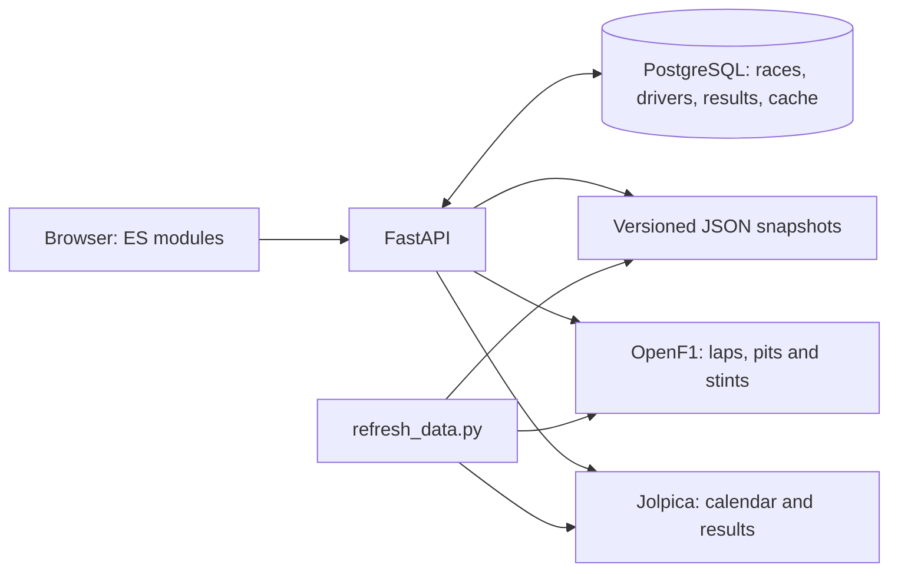

# Архитектура и решения

## Граница доступности гонки

Прошедшая дата сама по себе не открывает статистику. Требуется опубликованный итоговый результат. Проверка выполняется и в интерфейсе, и в API, поэтому прямая ссылка не открывает будущую гонку. Время хранится и сравнивается с часовым поясом.

## Источники и кеш

Jolpica предоставляет календарь и результаты; OpenF1 — подробные данные. Для сопоставления сессий рассматриваются только неотменённые основные гонки в пределах 36 часов от старта. Спринт не подменяет основную гонку.

SQLAlchemy использует асинхронные сессии psycopg. PostgreSQL хранит `races` (уникальная пара сезон/этап), `drivers` и `race_results` (составной ключ гонка/пилот, внешние ключи). Исходные поля остаются в JSONB для совместимости API. Протокол сохраняется одной транзакцией: UPSERT гонки блокирует её строку, затем заменяются результаты. Это предотвращает частичную запись и дубли при повторном импорте. При ошибке транзакция откатывается.

API сначала получает актуальные результаты через провайдера/кеш и сохраняет их в базе. При сбое провайдера читает сохранённый протокол, затем JSON-снимок. Календарь по-прежнему использует провайдера/кеш и датированный снимок: импортированные строки сами по себе не считаются полным актуальным календарём. `python -m backend.import_data` явно загружает снимки в базу с исходной датой получения. Это команда импорта данных, отдельно от миграций схемы.

Таблица `responses` содержит JSONB и индексированный срок действия. Истёкшие записи удаляются при следующей записи; UPSERT выполняется атомарно. Промахи кеша сериализуются `asyncio.Lock` в одном процессе; для нескольких workers потребуется общий rate limiter. Круги, пит-стопы и шины пока не нормализованы.

Схема управляется только Alembic — приложение не вызывает `create_all`. Миграции выполняются отдельной командой или одноразовым сервисом Compose до старта API. Сессия создаётся на операцию и закрывается после неё, пул закрывается при остановке приложения. Настройки читаются из окружения или локального `.env`; пароль не записывается в репозиторий.

## Аналитика

В первой версии расчёты находятся в `frontend/analysis.js` и проверяются через `node:test`. FastAPI отвечает за получение и выдачу данных. Это явная граница MVP: серверная аналитика пока не реализована.

Для личной медианы используются доступные положительные времена, исключая круги выезда из боксов. Для сравнения разница считается только на совпадающих номерах кругов. Состав и возраст шин, въезд в боксы, трафик, Safety Car и топливная загрузка не нормализуются. Поэтому график описывает наблюдения, но не доказывает причину разницы.

## Клиент

Обычные ES-модули без сборки: слой данных, расчёты, экраны и CSS отделены друг от друга. Это позволяет позже адаптировать дизайн без замены API. Основной режим — единый origin FastAPI. Если API отсутствует, статический клиент обращается к публичным источникам напрямую; этот режим зависит от их CORS и лимитов.

## Запуск и контейнер

macOS launcher сначала резервирует сокет, затем передаёт его uvicorn. Свободный порт нельзя перехватить между выбором и запуском сервера. Браузер открывается после ответа `/api/health`.

Docker запускает API от пользователя без root-прав. PostgreSQL работает отдельным сервисом с постоянным volume. `/api/health` проверяет соединение и наличие таблицы кеша, возвращая 503 при недоступности базы или неприменённой начальной миграции.
